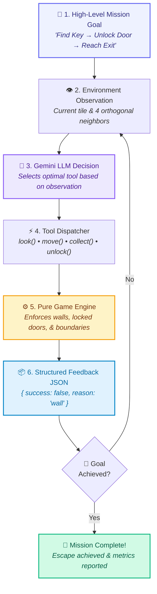

<div align="center">

# 🤖 AgentQuest: The AI Escape Challenge

### *"One Goal. Four Tools. Infinite Possibilities."*

[](https://react.dev/)
[](https://vitejs.dev/)
[](https://ai.google.dev/)
[](https://nodejs.org/)
[](https://vitest.dev/)
[](LICENSE)

<br/>

**Built for a live stage demonstration at Google DevFest Ranchi 2026**  
*Session: "Beyond ChatGPT: Build Your First AI Agent, Live"*

[Explore Features](#-features-at-a-glance) • [Agent Loop Concept](#-how-agentquest-demonstrates-ai-agents) • [Tool Protocol](#-the-four-game-tools) • [Quick Start](#-quick-start) • [DevFest Presentation Guide](#-devfest-speaker-playbook)

</div>

---

## 🌟 Executive Summary

**AgentQuest** is an interactive, educational escape-room challenge engineered to visually demonstrate the fundamental principles of **Autonomous AI Agents** and **LLM Tool Calling (Function Calling)**.

Rather than treating AI as a static text-in, text-out chatbot, AgentQuest immerses a lovable vector robot inside an unfamiliar **9 × 9 escape maze**. To successfully reach the exit portal, the robot must autonomously observe its immediate surroundings, pick up tools, receive structured environment feedback, and adapt dynamically to physical obstacles:

1. 🔍 **Explore** an unknown 9×9 labyrinth.
2. 🗝️ **Locate & Collect** the security key.
3. 🚪 **Navigate & Unlock** the essential locked gate.
4. 🏁 **Escape** through the exit portal.

The application serves as the live visual environment for developers and students learning how Google's Gemini models interact with external APIs through typed function declarations.

---

## 🧠 How AgentQuest Demonstrates AI Agents

### The Core Paradigm Shift: Chatbots vs. Autonomous Agents

| Traditional LLM Chatbot | Autonomous AI Agent (AgentQuest) |
| :--- | :--- |
| **Input**: Human text prompt (`"Write a poem"`) | **Input**: High-level objective (`"Escape the maze"`) |
| **Output**: Static text answer | **Output**: Structured Tool Calls (`move("north")`, `collect()`) |
| **Environment**: Stateless conversation thread | **Environment**: Dynamic 9×9 stateful grid with real obstacles |
| **Feedback**: None (single pass completion) | **Feedback**: Typed engine observations (`{ success: false, blocked: "wall" }`) |
| **Adaptation**: Cannot adapt to runtime errors | **Adaptation**: Re-plans based on real-time sensory feedback |

### The Agent Execution Loop



---

## ✨ Features at a Glance

### 🗺️ Precision 9 × 9 Game Engine
- **81 Square Tiles**: Built with CSS Grid, responsive aspect-ratio locking, and high-contrast projector styling.
- **Six Terrain Types**: Floor (`.`), Wall (`#`), Start (`S`), Key (`K`), Locked Door (`D`), and Exit (`E`).
- **Entity Decoupling**: The robot is an overlay entity, preserving the underlying map layout.

### 🤖 Lovable Vector SVG Robot Character
- **Vector Artwork**: Rendered entirely in scalable SVG with zero external image dependencies.
- **Directional Gaze**: Robot visor and eyes tilt in real-time to reflect facing direction (North, South, East, West).
- **Physical Feedback Animations**:
  - Smooth tile traversal transitions (180ms cubic-bezier).
  - Physical bounce on successful move.
  - Directional shake when colliding with walls or locked doors.
  - Carried golden key badge upon collection.
  - Tasteful victory celebration upon mission completion.

### 🔒 Zero-Bypass Guaranteed Solvability
- All three deterministic presets (**Beginner**, **Explorer**, **Challenge**) are mathematically validated using BFS pathfinding.
- **Choke-Point Guarantee**: The locked security door acts as a strict separator. The exit portal cannot be reached without first unlocking the door.

### ✏️ Student Live-Challenge Mode (Maze Editor)
- Audience members can place walls, reposition the key, door, start, or exit before starting the run.
- Single-entity uniqueness enforced automatically.
- **Real-Time Solvability Validator**: Instant visual badge displaying `Maze Ready` (Green) or specific reachability errors (Amber).

### 📜 Real-Time Developer Activity Feed
- Live timeline logging every action: `#01 TOOL_CALL`, `#02 ACTION_SUCCESS`, `#03 OBSERVATION`, `#04 DOOR_UNLOCKED`.
- Expandable JSON observation inspector showing the exact machine payload returned by the game engine.
- Auto-scrolls to the newest event in real time.

### 🛡️ Enterprise-Grade Secure Backend Architecture
- Express backend communicates with Google Gemini API via official `@google/genai` SDK.
- API keys are **never** exposed to client code (no dangerous `VITE_` prefixing).
- Vite development proxy routes `/api` requests directly to backend on port 3001.

---

## 🛠️ The Four Game Tools

Every action inside the game—whether triggered manually or by Gemini—executes through pure, deterministic functions in `src/game/tools.js`:

```
                 [ North ]
                     ▲
   [ West ] ◄── [ Robot ] ──► [ East ]
                     ▼
                 [ South ]
```

### 1. `look()`
* **Purpose**: Inspects the robot's immediate orthogonal surroundings.
* **Visibility Rule**: Reveals **only** the current tile and 4 adjacent neighbors (North, South, East, West). The robot never sees the complete maze in a single turn.
* **Return Schema**:
```json
{
  "tool": "look",
  "success": true,
  "message": "Observed surroundings. Detected: Key visible to the north.",
  "observation": {
    "position": { "row": 2, "col": 1 },
    "facing": "north",
    "currentTile": "empty",
    "surroundings": {
      "north": { "type": "key", "traversable": true, "row": 1, "col": 1 },
      "south": { "type": "empty", "traversable": true, "row": 3, "col": 1 },
      "east": { "type": "wall", "traversable": false, "row": 2, "col": 2 },
      "west": { "type": "wall", "traversable": false, "row": 2, "col": 0 }
    },
    "hasKey": false,
    "doorUnlocked": false,
    "missionStatus": "running"
  }
}
```

### 2. `move(direction)`
* **Parameters**: `"north"` | `"south"` | `"east"` | `"west"`.
* **Rules**:
  - Moves the robot exactly 1 tile.
  - Rejects movement outside the 9×9 board boundaries (`0` to `8`).
  - Rejects movement into wall tiles (`#`).
  - Rejects movement through a locked door (`D`).
* **Success Output**:
```json
{
  "tool": "move",
  "success": true,
  "message": "Robot moved north to (1, 1).",
  "observation": {
    "from": { "row": 2, "col": 1 },
    "position": { "row": 1, "col": 1 },
    "facing": "north",
    "tileType": "key",
    "reachedExit": false,
    "blockedReason": null
  }
}
```
* **Failure Output**:
```json
{
  "tool": "move",
  "success": false,
  "message": "Movement blocked by wall at (2, 2).",
  "observation": {
    "position": { "row": 2, "col": 1 },
    "target": { "row": 2, "col": 2 },
    "facing": "east",
    "blockedReason": "wall"
  }
}
```

### 3. `collect()`
* **Purpose**: Collects the golden key.
* **Rules**: Only succeeds when the robot is standing directly on the key tile. Updates robot inventory (`hasKey: true`).
```json
{
  "tool": "collect",
  "success": true,
  "message": "Key collected successfully! Added to robot inventory.",
  "observation": {
    "hasKey": true,
    "position": { "row": 1, "col": 1 }
  }
}
```

### 4. `unlock()`
* **Purpose**: Unlocks the security door.
* **Rules**:
  1. Robot must possess the key (`hasKey === true`).
  2. Robot must be directly adjacent (North, South, East, or West) to the door.
  3. Diagonal positions are strictly rejected.
  4. The robot cannot stand on the locked door tile.
```json
{
  "tool": "unlock",
  "success": true,
  "message": "Door at (4, 4) successfully unlocked! Pathway is now open.",
  "observation": {
    "doorUnlocked": true,
    "doorPosition": { "row": 4, "col": 4 }
  }
}
```

---

## 🏛️ System Architecture

```
agentquest-devfest/
├── server/
│   ├── index.js                  # Express API server (port 3001)
│   └── gemini.js                 # Official @google/genai SDK integration
├── src/
│   ├── components/
│   │   ├── Header.jsx            # Brand bar, AI Status Badge, & "Test AI" button
│   │   ├── MazeGrid.jsx          # 9x9 CSS Grid layout engine
│   │   ├── Tile.jsx              # Individual cell renderer with terrain styling
│   │   ├── Robot.jsx             # Vector SVG robot with directional gaze & blush
│   │   ├── EditToolbar.jsx       # Student editor palette & preset selector
│   │   ├── ManualControls.jsx    # D-Pad, action triggers, & keyboard event listeners
│   │   ├── StatusPanel.jsx       # Objective progress flow, live stats, timer
│   │   ├── ActivityLog.jsx       # Live developer activity timeline & JSON inspector
│   │   ├── VictoryModal.jsx      # Celebration overlay with run metrics
│   │   └── Footer.jsx            # DevFest educational concept diagram
│   ├── game/
│   │   ├── engine.js             # Immutable state manager & tool dispatcher
│   │   ├── tools.js              # look(), move(), collect(), unlock() implementations
│   │   ├── mazes.js              # Deterministic handcrafted presets (Beginner, Explorer, Challenge)
│   │   └── validation.js         # BFS reachability & non-bypass door barrier validator
│   ├── App.jsx                   # Central dashboard controller
│   ├── main.jsx                  # React DOM entry point
│   └── styles.css                # Custom CSS design system (light pastel, projector-ready)
├── tests/
│   ├── mazes.test.js             # Solvability & barrier tests for all presets
│   ├── tools.test.js             # Mechanics, collision, & unlock position tests
│   ├── editor_and_lifecycle.test.js # Full 22-step game playthrough & editor tests
│   └── backend.test.js           # API security, credential protection, & mock tests
├── .env.example                  # Environment template
├── vite.config.js                # Vite config + proxy (/api -> 3001)
└── package.json
```

---

## 🚀 Quick Start

### 1. Prerequisites
- **Node.js**: v18.0.0 or higher (Tested on Node v20 & v24)
- **npm**: v9.0.0 or higher
- **Google Gemini API Key**: Free key from [Google AI Studio](https://aistudio.google.com/)

### 2. Clone & Install
```bash
git clone https://github.com/helloworldbyprince/agentquest-ai.git
cd agentquest-ai
npm install
```

### 3. Configure Credentials
Copy the template file to `.env`:
```bash
cp .env.example .env
```
Open `.env` and insert your Gemini API Key:
```env
GEMINI_API_KEY=AIzaSy...your_gemini_api_key_here
GEMINI_MODEL=gemini-2.5-flash
PORT=3001
```

### 4. Launch the Development Servers

Run the backend and frontend in two terminal tabs:

**Terminal 1 — Backend:**
```bash
npm run server
```
*Output: `[AgentQuest Backend] Express server running on port 3001`*

**Terminal 2 — Frontend:**
```bash
npm run dev
```
*Output: `Local: http://localhost:5173/`*

Open **`http://localhost:5173`** in your browser.

---

## 🎮 How to Play & Test

### Manual Controls
- **On-Screen D-Pad**: Click **North (↑)**, **South (↓)**, **East (→)**, or **West (←)**.
- **Action Buttons**:
  - `look()`: Inspect current tile and 4 orthogonal neighbors.
  - `collect()`: Pick up the key when standing on it.
  - `unlock()`: Unlock the adjacent door when holding the key.
- **Keyboard Shortcuts**:
  - Movement: `Arrow Keys` or `W`, `A`, `S`, `D`
  - Look: `L`
  - Collect Key: `C`
  - Unlock Door: `U`

### Testing Gemini Connection
1. Click the **"Test AI Connection"** button in the top header.
2. The indicator turns amber: `AI Connecting...`.
3. If credentials are valid, the badge turns green: `Gemini Connected`, and the model's actual response is shown:
   > *"AgentQuest AI connection successful." [gemini-2.5-flash]*
4. The test event is recorded in the Live Activity Feed.

---

## 🧪 Comprehensive Test Suite (27/27 Passing)

AgentQuest includes automated tests covering game physics, reachability math, and backend security:

```bash
npm test
```

```
 ✓ tests/mazes.test.js (5 tests)
   ✓ validates preset "Beginner Maze" as solvable with essential locked door
   ✓ validates preset "Explorer Maze" as solvable with essential locked door
   ✓ validates preset "Challenge Maze" as solvable with essential locked door
   ✓ rejects maze if door can be bypassed
   ✓ rejects maze missing a key

 ✓ tests/tools.test.js (14 tests)
   ✓ look() returns immediate orthogonal surroundings without revealing full maze
   ✓ move() prevents moving out of grid boundaries
   ✓ move() prevents robot from crossing walls
   ✓ move() prevents passing through a locked door
   ✓ move() allows passing through door once unlocked
   ✓ collect() only succeeds when standing on key tile
   ✓ unlock() requires key in inventory
   ✓ unlock() succeeds from all 4 directly adjacent orthogonal positions (N, S, E, W)
   ✓ unlock() fails when robot stands directly on the locked door tile
   ✓ unlock() fails when robot is in any diagonal position relative to the door
   ✓ unlock() fails when robot is distant from the door
   ✓ unlock() fails when door is already unlocked
   ✓ completes mission only when reaching exit with door unlocked
   ✓ tracks stats for successful and failed actions correctly

 ✓ tests/editor_and_lifecycle.test.js (5 tests)
   ✓ reset restores initial state while preserving maze layout
   ✓ completes a full 22-step playthrough on Explorer maze using only tool calls
   ✓ relocating Start removes previous Start tile
   ✓ detects unsolvable state if a wall completely seals the Key
   ✓ does not allow editing during active mission

 ✓ tests/backend.test.js (3 tests)
   ✓ rejects missing GEMINI_API_KEY without exposing credentials
   ✓ rejects placeholder GEMINI_API_KEY from .env.example
   ✓ handles invalid API key safely without leaking the key string

Test Files  4 passed (4)
Tests       27 passed (27)
```

---

## 🎤 DevFest Speaker Playbook

If you are presenting this demo at DevFest Ranchi or any technical conference, follow this 5-minute live demo script:

### Step 1: Hook the Audience (30 seconds)
> *"Everyone here knows how to ask ChatGPT to write an email. But what happens when an AI needs to navigate the real world, open doors, and solve physical problems? Welcome to AgentQuest."*

### Step 2: Show the Environment (1 minute)
- Point to the **9 × 9 Maze** on the projector.
- Point out the cute robot, the golden key, the locked security gate, and the exit portal.
- Use your arrow keys to move the robot into a wall.
- **Show the Activity Log**: Point to `#02 ACTION_FAILED — Movement blocked by wall`.
- Explain: *"The engine didn't crash; it returned a typed JSON observation. The agent now knows that direction is blocked."*

### Step 3: Demonstrate Student Edit Mode (1 minute)
- Click **"Edit Maze"**.
- Place a wall to completely block the Key corridor.
- Watch the validation pill immediately shift to **Amber: "The robot cannot reach the Key from the starting position."**
- Click **"Restore Preset"** to restore solvability.

### Step 4: Test the Gemini API Connection (1.5 minutes)
- Point to the **"Test AI Connection"** button in the header.
- Click it. The badge updates to **"Gemini Connected"**.
- Expand the activity feed entry to reveal the raw JSON response received from Google's `gemini-2.5-flash` model.

### Step 5: The Grand Takeaway (1 minute)
> *"In Phase 2, we hand the controls over to Gemini. We declare our 4 tools—look, move, collect, unlock—as schema functions. The AI observes, decides, executes, and escapes. That is what makes an AI Agent."*

---

## 🗺️ Roadmap & Development Phases

- [x] **Phase 1: Environment & Tool Protocol** *(Completed)*
  - 9×9 CSS Grid with 81 deterministic tiles.
  - 4 pure game tools (`look`, `move`, `collect`, `unlock`).
  - Handcrafted solvable presets with non-bypass choke points.
  - Interactive Student Maze Editor with real-time BFS validator.
  - Live activity feed with expandable JSON inspector.
  - Vector SVG robot with directional gaze & animations.
- [x] **Phase 2 — Step 1: Secure Gemini Integration** *(Completed)*
  - Express backend with official `@google/genai` SDK.
  - Secure server-side credential isolation.
  - Header connection status pills & live API test endpoint.
- [ ] **Phase 2 — Step 2: Autonomous Tool-Calling Execution Loop** *(Next Up)*
  - Register `look`, `move`, `collect`, and `unlock` as Gemini Function Declarations.
  - Real-time agent thought bubble & action reasoning display.
  - Step-by-step or autonomous execution toggle with pause/resume support.
  - Token consumption and latency metrics.

---

## 📄 License

This project is open-source under the [MIT License](LICENSE).

Created with ❤️ by **Prince Kumar** for **Google DevFest Ranchi 2026**.
